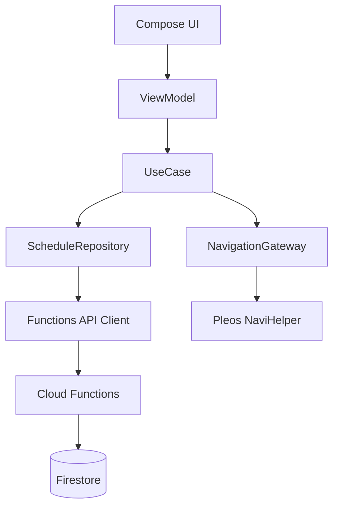

# Plain (그날은)

> **일정과 이동을 연결하는 차량용 스마트 캘린더**  
> A smart in-vehicle calendar for Pleos Connect.

Plain은 현대자동차그룹 **Pleos Connect** 환경을 대상으로 개발하는 차량용 스마트 캘린더 앱입니다.

사용자가 **Plain에 직접 일정을 생성·수정·삭제**하고, 출발 전 다가오는 일정을 확인하며, 일정에 등록된 장소를 차량 내비게이션 목적지로 연결하는 경험을 목표로 합니다.

- **프로젝트 유형:** 현대자동차그룹 Pleos 차량용 앱 공모전 출품 프로젝트
- **개발 환경:** Android Studio + Pleos Connect Emulator
- **현재 상태 (2026-11-02):** Android Studio 프로젝트 생성 완료, 자체 캘린더·Firebase 서버 설계 중
- **공모전 제출 목표:** 2026년 11월 15일
- **개발 원칙:** 작은 MVP, 팀 협업 가능한 구조, 운전자 주의 분산 최소화

---

## 1. 핵심 사용 시나리오

1. 사용자가 Plain에서 직접 일정을 등록합니다.
2. 캘린더 화면에서 날짜별 일정과 기념일(D-Day)을 확인합니다.
3. 출발 전 사용자가 브리핑을 요청하면 가까운 일정의 시간과 장소를 간단히 안내합니다.
4. 목적지가 있는 일정은 운전자 확인 후 내비게이션으로 연결합니다.
5. 주행 중에는 공식 앱 카테고리 및 주행 규제 정책에서 허용하는 동작만 제공합니다.

> **플랫폼 검증 사항:** Lifestyle 앱의 주행 중 음성 일정 조회, 시동 시 자동 실행, 시스템 Driving View 위젯 표시, NaviHelper 권한은 미확정입니다. 확인 전에는 주차 상태의 사용자 요청 기반 흐름을 기준으로 구현합니다.

---

## 2. 주요 기능

| 기능 | 내용 | 계획 |
| --- | --- | --- |
| 캘린더 | 월간 날짜 선택, 선택 날짜의 일정 조회 | MVP |
| 일정 관리 | 제목, 날짜·시간, 장소, 태그 입력 및 CRUD | MVP |
| 자체 서버 저장 | Cloud Functions를 통한 사용자별 일정 저장·조회 | MVP, 미구현 |
| 출발 전 일정 브리핑 | 임박한 일정의 시간·장소를 요약해 안내 | MVP, 호출 시점 검증 필요 |
| 내비게이션 | 일정 장소를 Pleos NaviHelper로 목적지 설정 | MVP, SDK 접근 및 동작 검증 필요 |
| D-Day | 기념일·주요 일정의 남은 날짜 표시 | MVP |
| 간략 위젯 | 다가오는 일정 요약 및 확장 목록 | 시연 범위, 표시 영역 검증 필요 |
| 외부 캘린더 동기화 | Google / Samsung / Apple 일정 가져오기 | 이번 MVP 범위 제외 |
| 반복 일정 | 매주·매월 반복 생성 | 후속 버전 검토 |

### 화면 구성

화면 기획서 `Plain_화면설계.pdf`를 기준으로 다음 화면을 구현합니다.

1. **캘린더 / 일정 등록:** 날짜 선택, 일정 정보 및 태그 입력
2. **출발 전 브리핑:** 가까운 일정 안내 및 목적지 이동 제안
3. **D-Day 위젯:** 주요 기념일을 간략하게 표시
4. **확장 위젯:** 위젯 선택 시 다가오는 일정 목록 표시

---

## 3. 기술 스택

아래는 **초기 설계 제안**입니다. 확정 버전은 팀 공용 개발 환경이 준비되면 이 문서의 환경 표에 기록합니다.

| 분류 | 기술 | 사용 목적 |
| --- | --- | --- |
| 언어 | Kotlin | Android 앱 개발 |
| UI | Jetpack Compose | 선언형 화면 및 상태 처리 |
| 패턴 | MVVM + Repository | UI, 화면 상태, 데이터 접근 책임 분리 |
| 서버 데이터 저장 | Cloud Firestore (제안) | 일정의 기준 저장소(Source of Truth) |
| 서버 비즈니스 로직 | Firebase Cloud Functions (제안) | 인증·권한 검사·일정 CRUD·유효성 검증 |
| 인증 | 사용자 계정 인증 (방식 미확정) | 사용자별 일정 접근 통제 |
| 로컬 캐시 (선택) | Room | 오프라인 읽기 전용 일정 표시; 초기 필수 아님 |
| 비동기 | Kotlin Coroutines / Flow | 데이터 관찰, SDK·네트워크 호출 |
| 내비게이션 | Pleos NaviHelper SDK | 목적지 설정 및 내비게이션 연동 |
| 서버 개발 | TypeScript (제안) | Cloud Functions 구현 |
| 테스트 | JUnit, Compose UI Test, Pleos Connect Emulator | 단위·UI·차량 환경 검증 |

### 캘린더 데이터 관리 원칙

Google·Samsung·Apple Calendar와의 양방향 연동 대신 **Plain 자체 캘린더**를 구현하기로 결정했습니다.

**Firebase Cloud Functions + Firestore는 이를 위한 서버 구성 제안**이며, 팀에서 계정 정책과 함께 확정해야 합니다.

- **일정 생성·조회·수정·삭제:** Plain 화면에서 요청하고 Cloud Functions가 처리
- **단일 기준 저장소:** Firestore에 저장된 서버 확정 데이터를 기준으로 표시
- **보안:** 클라이언트에서 Firestore를 직접 수정하지 않고, 서버에서 사용자 권한과 데이터를 검증
- **오프라인:** 네트워크가 없으면 저장 성공으로 처리하지 않음. Room을 도입할 경우 마지막 서버 응답만 읽기 전용으로 표시
- **외부 연동:** 초기 공모전 범위에서 제외하고 후속 기능으로 재검토

---

## 4. 아키텍처

앱은 **한 개의 Android 앱 모듈**에서 시작하고, 패키지 경계로 책임을 나눕니다.

아래는 예정 구조이며 현재 구현된 파일 목록이 아닙니다.

### 4.1 Project Structure

```text
app/src/main/java/<package-name>/
├── app/                    # 앱 진입점 및 전체 설정
├── ui/
│   ├── calendar/           # 캘린더, 날짜별 일정
│   ├── schedule/           # 일정 생성·상세·편집
│   ├── briefing/           # 출발 전 일정 브리핑
│   └── widget/             # D-Day 및 일정 요약 UI
├── domain/
│   ├── model/              # UI/저장소와 독립적인 일정 모델
│   ├── repository/         # 데이터 접근 인터페이스
│   └── usecase/            # 일정 조회, 브리핑, 목적지 요청
├── data/
│   ├── remote/             # Cloud Functions API 요청·응답
│   ├── local/              # Room 읽기 캐시 (선택)
│   └── repository/         # Repository 구현체
├── vehicle/
│   ├── navigation/         # Pleos NaviHelper 연동 경계
│   ├── restriction/        # CarUxRestrictions 상태 관리
│   └── audio/              # TTS·오디오 포커스 관리
└── core/                   # 공통 유틸, 오류, 시간 처리

functions/src/               # Firebase Cloud Functions (TypeScript 제안)
├── schedules/              # 일정 CRUD 및 조회
├── auth/                   # 사용자 인증·인가
└── shared/                 # 요청 검증·오류 처리
```

### 4.2 Architecture Overview



Cloud Functions는 다음 작업을 담당합니다.

- 요청 인증
- 일정 소유권 확인
- 필드 검증
- 중복 생성 방지
- 수정 충돌 검사
- 일정 생성·조회·수정·삭제
- 서버 오류 처리

클라이언트는 서버에서 확정한 응답을 받아 UI를 갱신합니다.

Pleos SDK 구현을 화면에서 직접 호출하지 않고 인터페이스 뒤로 분리합니다.

이를 통해 Emulator가 없는 개발 환경에서는 가짜 데이터 및 테스트용 구현으로 화면 개발이 가능합니다.

### 4.3 주요 데이터 모델

| 모델 | 핵심 데이터 | 목적 |
| --- | --- | --- |
| Schedule | id, title, startAt, endAt, timeZoneId, isAllDay, location, tags, revision | 자체 캘린더 일정 |
| ScheduleLocation | address, latitude?, longitude? | 입력 주소와 검증된 좌표 구분 |
| Anniversary | id, title, date | D-Day 정보 |

### 4.4 Firestore 데이터 구조

Firestore 구조 초안:

```text
users/{userId}/schedules/{scheduleId}
    title
    description
    startAt
    endAt
    timeZoneId
    isAllDay
    location
    tags
    revision
    createdAt
    updatedAt

users/{userId}/anniversaries/{anniversaryId}
    title
    date
```

데이터 설계 원칙:

- 서버 시각은 UTC 기준으로 저장하고 표시할 때 `timeZoneId`를 사용합니다.
- 종일 일정은 날짜 경계 및 시간대 처리 방식을 별도로 검증합니다.
- `revision`은 서버가 관리하며, 동시 수정 충돌 방지에 사용합니다.
- 주소만으로 NaviHelper 좌표 변환이 가능하다고 가정하지 않습니다.
- 필요 시 **지오코딩(주소 → 좌표)** 경로를 별도로 검토합니다.

### 4.5 서버 API 설계

| 함수 | 역할 |
| --- | --- |
| getSchedules(range) | 조회 기간의 사용자 일정 반환 |
| getSchedule(id) | 일정 상세 조회 |
| createSchedule(input, requestId) | 새 일정 생성, 재시도 중복 방지 |
| updateSchedule(id, changes, revision) | 일정 수정 및 버전 충돌 검사 |
| deleteSchedule(id, revision) | 일정 삭제 |
| getUpcomingSchedules(now, range) | 브리핑용 일정 조회 |

실제 요청·응답 형식, 인증 방식 및 Callable/HTTPS 적용 여부는 개발 환경에서 검증 후 확정합니다.

### 4.6 네트워크 장애와 동시 수정 대응

1. **서버 저장 성공 전에는 '저장 완료'를 표시하지 않습니다.**
2. 네트워크 실패 시 오류를 보여주고 사용자가 재시도할 수 있도록 합니다.
3. 중복 생성 방지를 위해 요청별 고유 `requestId`를 서버에서 검증하도록 설계합니다.
4. 수정 요청의 `revision`이 최신 버전과 다르면 무조건 덮어쓰지 않고 충돌을 반환합니다.
5. Room 캐시를 도입하더라도 서버 확정 데이터의 **읽기 전용 사본**으로 제한합니다.
6. 초기에는 오프라인 작성 큐나 자동 양방향 동기화를 구현하지 않습니다.

### 4.7 차량 연동 정책

#### NaviHelper

1. 일정에 등록한 목적지 주소의 유효성을 확인합니다.
2. 주소를 좌표로 변환하는 방법을 검증합니다.
3. NaviHelper 자체 지오코딩 지원 여부는 **미확인**입니다.
4. 유효한 목적지 데이터를 NaviHelper에 전달하고 콜백으로 결과를 확인합니다.
5. Plain은 직접 TBT 길 안내를 제공하지 않고 차량 내비게이션에 위임합니다.

#### 브리핑 / 오디오

- 출발 전 브리핑의 기본 시작 방식은 **사용자 요청**입니다.
- Pleos TTS를 사용할 경우 재생 전 오디오 포커스를 요청하고 상실 이벤트를 처리합니다.
- Suspend 진입 시 음성을 중단하고 포커스 및 리소스를 해제합니다.
- 시동 시 자동 안내와 주행 중 음성 조회는 플랫폼 허용 여부 확인 후 결정합니다.

#### 주행 안전 / UI

- 앱 분류는 현재 **Lifestyle 검토 중**입니다.
- `CarUxRestrictionsManager`의 변경 이벤트에 따라 제한 대상 UI 및 동작을 중단합니다.
- 주행 중 음성 안내 또는 내비 목적지 요청이 허용된다고 임의로 가정하지 않습니다.
- 시스템 Driving View 영역의 서드파티 위젯 사용 가능 여부를 별도로 검증합니다.

---

## 5. 개발 환경 설정

### 5.1 준비물

1. Android Studio 및 팀에서 합의한 JDK
2. Android SDK / 프로젝트 Gradle Wrapper
3. [Pleos Playground](https://pleos.ai/playground) 프로젝트 접근 권한
4. 팀에서 지정한 Pleos Connect SDK 및 Emulator
5. Android Studio AVD에 구성된 Pleos Connect Emulator
6. Firebase 프로젝트 (Cloud Functions + Firestore) 및 서버 개발 도구

### 5.2 팀 공통 버전

| 구성 요소 | 사용 버전 | 비고 |
| --- | --- | --- |
| Android Studio | TBD | 팀에서 확정 후 기입 |
| JDK | TBD | Gradle/AGP 요구 버전 확인 |
| Android SDK (compileSdk) | TBD | 프로젝트 설정 파일 기준 |
| Android Gradle Plugin | TBD | Gradle 설정 파일 기준 |
| Gradle Wrapper | TBD | gradle/wrapper/gradle-wrapper.properties 기준 |
| Pleos Connect SDK | TBD | 팀 공지 없이 업데이트 금지 |
| Pleos Connect Emulator | TBD | 모든 팀원 동일 버전 |
| Cloud Functions 런타임 | TBD | 서버 팀 합의 후 확정 |

SDK 또는 Emulator를 변경할 때에는 먼저 팀에 공지하고, 호환성 확인 후 함께 업데이트합니다.

### 5.3 실행

```bash
git clone <REPOSITORY_URL>
cd Plain
```

1. Android Studio에서 프로젝트를 엽니다.
2. Gradle Sync가 완료되는지 확인합니다.
3. Pleos Connect Emulator가 설치된 AVD를 실행합니다.
4. `app` 실행 구성을 선택하여 앱을 설치·실행합니다.

빌드만 확인할 경우:

```bash
# macOS / Linux
./gradlew assembleDebug

# Windows PowerShell
.\gradlew.bat assembleDebug
```

> 현재 프로젝트는 기능 구현 전이므로 Pleos SDK 연결 및 위 명령의 실제 빌드 결과를 검증한 뒤 체크리스트를 갱신합니다.

### 5.4 인증정보 및 보안

- `local.properties`, `.env`, 키스토어, 개인 토큰, Client Secret은 Git에 커밋하지 않습니다.
- Android 앱 패키지에 비밀키를 하드코딩하지 않습니다.
- 모바일 앱에 포함된 비밀값은 추출될 수 있습니다.
- 사용자별 인증 방식은 확정 전입니다.
- Pleos Emulator에서 GMS/Google 계정 로그인을 당연히 지원한다고 가정하지 않습니다.
- Cloud Functions는 **요청마다 사용자 인증과 일정 소유권을 검증**합니다.
- 서버 SDK는 Firestore Security Rules를 우회할 수 있으므로 별도 인가 처리가 필수입니다.
- 로그에 인증 토큰, 사용자 일정 내용, 위치정보 등의 민감정보를 남기지 않습니다.
- 로그아웃·계정 전환·일정 삭제 시 데이터 접근 차단과 세션 해제 정책을 정의합니다.

---

## 6. Git 협업 규칙

### 6.1 Branch Strategy

```text
main                     # 검증된 통합 브랜치
feature/calendar-ui      # 기능 개발 예시
feature/schedule-api
feature/firebase-storage
feature/auth
feature/briefing
feature/pleos-navigation
fix/<issue-name>         # 결함 수정
```

협업 규칙:

1. 기능 개발은 `main`에서 새 브랜치를 생성해 진행합니다.
2. PR에는 변경 내용, 테스트 결과, 영향 범위를 작성합니다.
3. 가능하면 **팀원 1명 이상 리뷰** 후 `main`에 병합합니다.
4. `main` 직접 푸시와 Force Push는 금지합니다.
5. 브랜치는 기능 병합 후 정리합니다.

### 6.2 Commit Convention

```text
feat: add calendar month screen
fix: handle missing schedule location
refactor: separate schedule repository
test: add schedule repository tests
docs: update emulator setup
chore: configure project dependencies
```

### 6.3 코드 작성 원칙

- 클래스·함수·변수명은 **역할이 드러나는 영어 이름**으로 작성합니다.
- 클래스와 주요 함수에는 목적·매개변수·반환값·부작용을 **한국어 주석/KDoc**으로 필요한 만큼 설명합니다.
- 상태값은 무엇을 저장하며 언제 변경되는지 기록합니다.
- 복잡한 분기, 시간 계산, 비동기 취소, SDK 제약은 **왜 필요한지** 주석으로 남깁니다.
- 명백한 코드를 그대로 읽는 주석은 생략합니다.
- 함수는 가능한 한 하나의 책임만 갖게 합니다.
- 요청 범위 밖의 구조 변경이나 과도한 추상화는 피합니다.
- null, 권한 거부, 네트워크 실패, 중복 호출, 화면 종료 시 작업 취소를 고려합니다.
- PR 설명에는 구현 내용, 주요 변경점, 팀원이 주의할 사항, 테스트 방법을 포함합니다.

---

## 7. 개발 계획

### 7.1 현재 개발 현황 (2026-11-02)

| 항목 | 상태 |
| --- | --- |
| Android Studio 프로젝트 | 생성 완료 |
| 화면 기획 및 UX | 설계 초안 작성 |
| 자체 캘린더 방향 | 팀 결정 |
| Firebase 인증·Firestore·Cloud Functions | 기술 제안 및 상세 설계 중, 미구현 |
| 캘린더 UI / 일정 CRUD | 미구현 |
| 브리핑 / D-Day | 미구현 |
| NaviHelper / TTS | SDK 검증 예정 |
| Pleos Emulator 통합 테스트 | 미진행 |

### 7.2 남은 일정

| 기간 (2026) | 목표 | 확인 기준 |
| --- | --- | --- |
| 11/02–11/04 | Firebase 환경, 인증 방식 검토, Functions/Firestore 연결 | API 호출 및 사용자별 데이터 접근 검증 |
| 11/05–11/08 | 캘린더 UI, 일정 CRUD, 서버 저장 | 생성·조회·수정·삭제 시나리오 검증 |
| 11/09–11/11 | 출발 전 브리핑, D-Day, NaviHelper 검증 | Emulator에서 주요 데모 흐름 확인 |
| 11/12–11/14 | 통합, 오류·주행 규제·화면 테스트, 기획서/영상 준비 | 제출 가능한 안정적인 데모 |
| 11/15 | 공모전 제출 마감 | 제출 여부 확인 |

일정은 **목표**이며 SDK 접근·인증 방식·주행 정책 확인에 따라 조정합니다.

**기획서가 필수 제출물**이며 데모 영상과 구현물은 준비 상황에 따라 선택 제출합니다.

시연 기능이 Mock이면 명확히 구분합니다.

---

## 8. 테스트 체크리스트

- [ ] 새로 Clone한 프로젝트가 팀 공통 환경에서 빌드되는가?
- [ ] 자체 일정 생성·조회·수정·삭제 및 앱 재실행 후 서버 데이터가 유지되는가?
- [ ] 일정이 없는 날짜와 필수 입력값 누락을 처리하는가?
- [ ] 사용자 A가 사용자 B의 일정을 읽거나 수정할 수 없는가?
- [ ] 시간대, 자정 경계, 종일 일정의 표시 기준을 확인했는가?
- [ ] 네트워크 실패 시 저장 성공으로 오인시키지 않는가?
- [ ] 일정 생성 요청을 재시도해도 중복 생성되지 않는가?
- [ ] 여러 기기에서 수정 시 버전 충돌을 감지하는가?
- [ ] 유효하지 않은 장소나 내비게이션 연결 오류를 처리하는가?
- [ ] 출발 전 브리핑이 중복 실행되거나 화면 생명주기를 벗어나지 않는가?
- [ ] 주행 중 사용자 조작과 정보 표시가 차량 UI 정책에 부합하는가?
- [ ] TTS 오디오 포커스 상실 및 차량 Suspend/Resume를 처리하는가?
- [ ] SDK 연결/해제 및 비동기 작업 취소가 정상 동작하는가?

---

## 9. 확인 중인 사항

- [ ] 차량 사용자별 일정 인증 및 계정 전환을 어떤 방식으로 구현할 것인가?
- [ ] Pleos Emulator에서 선택한 인증 방식이 동작하는가?
- [ ] 시동 이벤트 또는 출발 시점을 앱에 전달받을 수 있는가?
- [ ] 시스템 Driving View 영역에 서드파티 위젯을 표시할 수 있는가?
- [ ] NaviHelper에서 도로명 주소를 좌표로 변환할 수 있는가?
- [ ] 외부 지오코딩이 필요한가?
- [ ] Lifestyle 앱의 주행 중 음성 일정 조회·목적지 요청이 허용되는가?
- [ ] TTS 오디오 포커스·Suspend 정책을 Pleos SDK와 어떻게 연동하는가?

해당 사항은 **미확정 설계 항목**이며 실제 API/정책 확인 뒤 이 문서와 기술 설계서를 갱신합니다.

---

## 10. 참고 자료

### Pleos Connect

- [Pleos Playground](https://pleos.ai/playground)
- [Pleos Connect 앱 개발 시작하기](https://document.pleos.ai/docs/pleos-only/getting-started)
- [Pleos Connect Emulator 설치 안내](https://document.pleos.ai/docs/connect/guide/getting-started/application-development/setup-connect-sdk-emulator)
- [NaviHelper API](https://document.pleos.ai/en/api-reference/connect-sdk-pleos/NaviHelper/intro)
- [Pleos 앱 카테고리](https://document.pleos.ai/docs/pleos-only/vehicle-app-planning-guide/app-category)
- [Pleos 주행 규제 개발 가이드](https://document.pleos.ai/docs/pleos-only/vehicle-app-developer-guide/driving-restriction-development-guide)
- [Pleos 오디오 포커스 가이드](https://document.pleos.ai/docs/pleos-only/vehicle-app-developer-guide/audio-focus-development-guide/audio-focus-development)

### Firebase

- [Firestore 데이터 모델](https://firebase.google.com/docs/firestore/data-model)
- [Cloud Functions Callable API](https://firebase.google.com/docs/functions/callable)
- [Firestore Security Rules](https://firebase.google.com/docs/firestore/security/get-started)

---

**Plain — 일정을 확인하는 순간부터 목적지에 도착하는 순간까지.**
