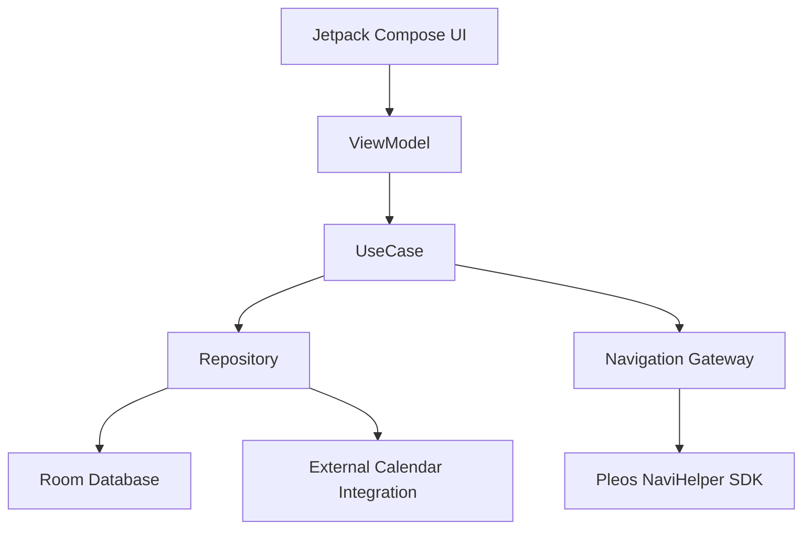
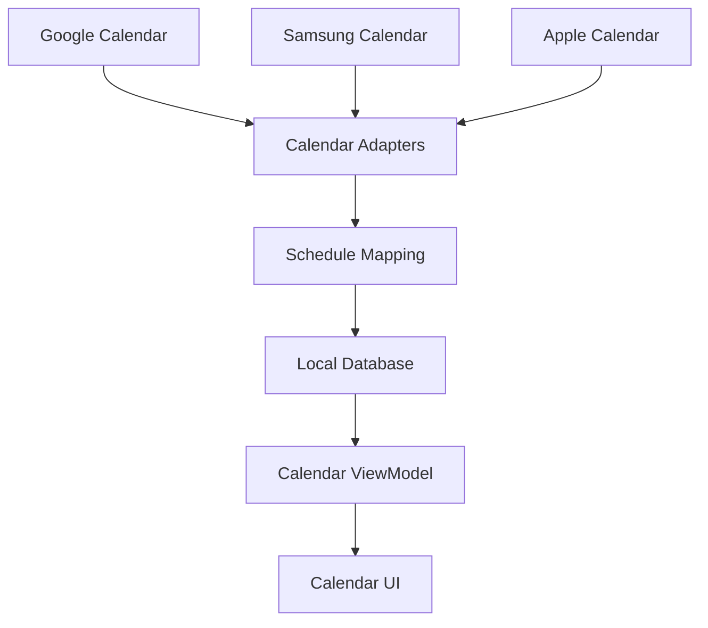

# Plain (그날은)

### Smart Calendar for Pleos Connect

Plain은 현대자동차그룹 Pleos Connect 플랫폼을 기반으로 개발하는 차량용 스마트 캘린더 애플리케이션입니다.

Google, Samsung, Apple 캘린더의 일정을 통합 관리하고, 차량 출발 시 다가오는 일정을 안내하며, 일정에 등록된 장소를 내비게이션 목적지로 연결하는 것을 목표로 합니다.

단순한 일정 관리 애플리케이션을 넘어, 운전자의 일정과 이동 경험을 연결하는 차량 환경에 최적화된 서비스를 지향합니다.

## 1. Project Overview

| 항목 | 내용 |
|------|------|
| Project | Plain (그날은) |
| Platform | Pleos Connect / Android |
| Language | Kotlin |
| IDE | Android Studio |
| UI Framework | Jetpack Compose (설계) |
| Architecture | MVVM + Repository Pattern (설계) |
| Local Database | Room (설계) |
| Asynchronous Processing | Kotlin Coroutines / Flow (설계) |
| Vehicle Integration | Pleos Connect SDK / NaviHelper (검증 예정) |
| Test Environment | Pleos Connect Emulator |
| Development Status | Initial Development |
| Target | Hyundai Motor Group Pleos App Challenge |

## 2. Core Features

### 2.1 Calendar Management

사용자는 캘린더 화면에서 날짜별 일정을 확인하고 새로운 일정을 등록할 수 있습니다.

주요 기능:

- 월간 캘린더 표시
- 날짜별 일정 목록 조회
- 일정 생성 및 수정
- 일정 제목 및 설명 관리
- 시작 시간과 종료 시간 설정
- 일정 장소 등록
- 일정 태그 및 카테고리 관리

### 2.2 External Calendar Integration

외부 캘린더의 일정을 가져와 Plain에서 통합 조회하는 기능을 목표로 합니다.

연동 대상:

- Google Calendar
- Samsung Calendar
- Apple Calendar

외부 일정은 공통 데이터 모델로 변환하여 화면에 표시하도록 설계합니다.

서비스마다 인증 방식과 데이터 접근 방법이 다르므로, 실제 연동 가능 범위는 공식 API 및 Pleos 환경에서 검증할 예정입니다.

### 2.3 Schedule Briefing

차량 이용을 시작할 때 가까운 일정을 요약해 안내하는 기능입니다.

예상 사용 흐름:

1. 사용자가 차량 이용을 시작합니다.
2. Plain이 현재 시간을 기준으로 다가오는 일정을 조회합니다.
3. 일정의 제목, 시작 시간, 장소를 정리합니다.
4. 사용자에게 일정 정보를 표시합니다.
5. 사용자가 이동을 선택하면 내비게이션으로 목적지를 전달합니다.

차량 시동 이벤트와 자동 실행 가능 여부는 Pleos SDK의 지원 범위를 확인해야 합니다.

### 2.4 Navigation Integration

일정에 등록된 장소를 Pleos 내비게이션과 연결합니다.

NaviHelper SDK를 이용한 목적지 설정을 검토하고 있습니다.

예상 처리 과정:

1. 일정에서 장소 정보 조회
2. 목적지 데이터 유효성 확인
3. NaviHelper SDK에 목적지 설정 요청
4. SDK 콜백으로 처리 결과 확인
5. 요청 성공 또는 실패 상태 표시

### 2.5 D-Day Widget

기념일과 주요 일정까지 남은 날짜를 계산하여 표시합니다.

주요 기능:

- D-Day 계산
- 기념일 목록 관리
- 다가오는 일정 요약
- 선택 시 상세 일정 표시

시스템 Driving View 영역에 위젯을 표시할 수 있는지는 플랫폼 정책 검증 후 결정합니다.

---

## 3. Technical Architecture

Plain은 유지보수와 기능 확장을 고려하여 MVVM 아키텍처와 Repository Pattern을 기반으로 설계합니다.

### 3.1 Architecture Overview



각 계층의 역할은 다음과 같습니다.

### Presentation Layer

사용자에게 화면을 표시하고 UI 이벤트를 처리합니다.

주요 구성:

- Compose Screen
- ViewModel
- UI State

화면에서는 직접 데이터베이스나 외부 SDK를 호출하지 않도록 설계합니다.

### Domain Layer

일정 관리와 브리핑 등의 비즈니스 로직을 처리합니다.

예상 UseCase:

- GetSchedulesUseCase
- CreateScheduleUseCase
- UpdateScheduleUseCase
- GetUpcomingSchedulesUseCase
- GetAnniversariesUseCase
- RequestNavigationUseCase

### Data Layer

로컬 데이터와 외부 캘린더 데이터를 관리합니다.

주요 구성:

- Room Database
- DAO
- Repository Implementation
- External Calendar Adapter

### Vehicle Integration Layer

Pleos Connect SDK와의 연동을 담당합니다.

차량 SDK에 대한 의존성을 별도 계층으로 분리하여 UI 및 도메인 로직이 특정 SDK 구현에 직접 종속되지 않도록 설계합니다.

---

## 4. Project Structure

아래는 개발 예정 패키지 구조입니다.

```text
app/
└── src/
    └── main/
        └── java/
            └── <package-name>/
                │
                ├── app/
                │   └── AppEntry
                │
                ├── ui/
                │   ├── calendar/
                │   ├── schedule/
                │   ├── briefing/
                │   └── widget/
                │
                ├── domain/
                │   ├── model/
                │   ├── repository/
                │   └── usecase/
                │
                ├── data/
                │   ├── local/
                │   ├── calendar/
                │   └── repository/
                │
                ├── vehicle/
                │   └── navigation/
                │
                └── core/
                    ├── util/
                    └── error/
```

각 패키지는 기능과 책임을 기준으로 구분합니다.

초기에는 단일 Android 앱 모듈을 유지하며, 프로젝트 규모가 증가할 경우 모듈 분리를 검토합니다.

---

## 5. Data Design

외부 캘린더와 로컬 일정을 통합하기 위해 공통 일정 모델을 사용하도록 설계합니다.

### 5.1 Schedule

일정의 기본 정보를 저장하는 모델입니다.

```kotlin
data class Schedule(
    val id: String,
    val title: String,
    val description: String?,
    val startAt: Long,
    val endAt: Long,
    val timeZone: String,
    val location: String?,
    val tags: List<String>
)
```

주요 필드:

- id: 일정 식별자
- title: 일정 제목
- description: 상세 설명
- startAt: 시작 시각
- endAt: 종료 시각
- timeZone: 일정 시간대
- location: 일정 장소
- tags: 일정 분류 태그

위 코드는 데이터 모델 설계 예시이며, 실제 Room Entity 및 외부 캘린더 매핑 구현 시 조정할 예정입니다.

### 5.2 CalendarSource

외부 캘린더의 출처를 구분합니다.

```kotlin
enum class CalendarProvider {
    LOCAL,
    GOOGLE,
    SAMSUNG,
    APPLE
}
```

### 5.3 External Event Mapping

외부 캘린더 이벤트와 로컬 일정의 연결 정보를 관리할 예정입니다.

주요 데이터:

- Provider
- Calendar ID
- External Event ID
- Local Schedule ID

동일한 외부 일정이 중복 저장되는 문제를 방지하고, 동기화 시 기존 일정을 식별하는 데 사용합니다.

---

## 6. Calendar Synchronization Design

외부 캘린더 데이터는 각 서비스의 연동 계층을 통해 조회하고, 앱 내부의 공통 Schedule 모델로 변환하도록 설계합니다.



동기화에서 고려할 사항:

1. 사용자 인증 및 접근 권한
2. 일정 중복 방지
3. 시간대 변환
4. 종일 일정 처리
5. 반복 일정 처리
6. 외부 일정 변경 감지
7. 삭제된 일정 반영
8. 네트워크 오류 및 권한 만료 처리

외부 서비스별 지원 범위가 확인되기 전까지 모든 연동을 동일한 방식으로 구현할 수 있다고 가정하지 않습니다.

---

## 7. Pleos Connect Integration

차량 환경의 기능을 사용하기 위해 Pleos Connect SDK 연동을 계획하고 있습니다.

### 7.1 NaviHelper SDK

예상 활용 기능:

- 일정 장소 기반 목적지 설정
- 내비게이션 요청 결과 확인
- 경로 안내 상태와 연동

SDK 호출은 별도의 Navigation Gateway를 통해 수행하도록 설계합니다.

### 7.2 Vehicle Lifecycle

차량 환경에서는 일반 모바일 앱과 달리 다음 상황을 고려해야 합니다.

- 차량 이용 시작과 종료
- 앱 화면 전환
- 백그라운드 진입
- SDK 연결 및 연결 해제
- 주행 중 사용자 조작 제한

특히 시동 이벤트 수신, 자동 실행, 시스템 위젯 노출은 실제 권한과 API 제공 여부를 확인한 후 구현합니다.

### 7.3 Driver Distraction

운전자의 주의 분산을 최소화하도록 UI를 구성합니다.

주요 원칙:

- 주행 중 복잡한 일정 편집 제한
- 필요한 일정 정보만 간결하게 표시
- 목적지 설정 시 명확한 사용자 확인
- 차량 UI 정책에 적합한 화면 구성

---

## 8. Asynchronous Processing

비동기 작업은 Kotlin Coroutines 및 Flow 기반으로 설계합니다.

적용 대상:

- 일정 데이터 조회
- 외부 캘린더 동기화
- 로컬 데이터 변경 감지
- Pleos SDK 연동
- 화면 상태 업데이트

다음 상황을 고려합니다.

- 중복 요청 방지
- 네트워크 및 SDK 오류 처리
- 화면 종료 시 불필요한 작업 취소
- 로딩 및 실패 상태 구분
- 리소스 초기화와 해제

---

## 9. Development Environment

### Required Tools

- Android Studio
- Kotlin
- Android SDK
- Gradle
- Pleos Connect Emulator
- Pleos Connect SDK

### Build

프로젝트를 Clone한 뒤 Android Studio에서 Gradle Sync를 진행합니다.

```bash
git clone <REPOSITORY_URL>
cd Plain
```

Windows:

```bash
.\gradlew.bat assembleDebug
```

macOS / Linux:

```bash
./gradlew assembleDebug
```

실제 빌드 및 실행 가능 여부는 개발 환경 설정 후 확인할 예정입니다.

Pleos SDK와 Emulator는 모든 팀원이 동일한 버전을 사용합니다.

---

## 10. Development Status

현재 개발 현황입니다.

| 항목 | 상태 |
|------|------|
| 프로젝트 요구사항 정리 | 완료 |
| 화면 구성 및 UX 설계 | 완료 |
| 기술 스택 및 아키텍처 초안 | 완료 |
| 데이터 구조 초안 | 완료 |
| Android Studio 프로젝트 생성 | 완료 |
| Gradle 및 의존성 설정 검증 | 예정 |
| Calendar UI 구현 | 예정 |
| Room Database 구현 | 예정 |
| 외부 캘린더 연동 | 기술 검증 예정 |
| Pleos NaviHelper 연동 | 기술 검증 예정 |
| Schedule Briefing 구현 | 예정 |
| D-Day Widget 구현 | 예정 |
| Emulator 통합 테스트 | 예정 |

본 문서의 코드와 구조는 현재 기술 설계 기준이며, 실제 구현 상태에 따라 지속적으로 업데이트합니다.

---

## 11. Collaboration Guidelines

프로젝트는 여러 개발자가 함께 수정하고 확장할 수 있도록 다음 규칙을 따릅니다.

### Naming Convention

- 클래스, 함수, 변수는 역할을 알 수 있는 영어 이름 사용
- 의미가 불명확한 축약어 사용 지양
- 함수는 가능한 한 하나의 책임만 수행

### Documentation

- 주요 클래스의 목적과 책임 주석 작성
- 주요 함수의 동작 및 입출력 설명
- 중요한 상태값의 변경 시점 설명
- 복잡한 계산과 비동기 로직의 구현 이유 명시
- 팀원이 수정할 때 주의할 사항 기록

주석은 한국어로 작성합니다.

코드 자체로 의미가 명확한 부분에는 불필요한 주석을 추가하지 않습니다.

### Git Workflow

브랜치 전략:

```text
main
feature/calendar-ui
feature/calendar-sync
feature/schedule-storage
feature/briefing
feature/pleos-navigation
fix/<issue-name>
```

협업 규칙:

1. 기능별 브랜치 생성
2. 기능 구현 및 테스트
3. Pull Request 생성
4. 팀원 코드 리뷰
5. 검증 후 main 브랜치 병합

### Commit Convention

```text
feat: add calendar screen
fix: handle empty schedule
refactor: separate schedule repository
test: add calendar tests
docs: update README
chore: configure dependencies
```

---

## 12. Testing Strategy

### Unit Test

- 일정 생성 및 조회 로직
- 날짜 및 시간 계산
- D-Day 계산
- 일정 데이터 변환
- 중복 일정 처리

### UI Test

- 날짜 선택
- 일정 목록 출력
- 일정 생성 화면
- 브리핑 화면
- D-Day 위젯

### Integration Test

- Room Database 연동
- 외부 캘린더 권한 및 데이터 조회
- Pleos NaviHelper 호출
- SDK 연결 오류 처리

### Emulator Test

Pleos Connect Emulator에서 다음 항목을 확인합니다.

- 화면 표시 및 해상도
- 차량 환경에서의 앱 실행
- 내비게이션 연동
- 브리핑 흐름
- 주행 중 UI 제약사항

---

## 13. Development Roadmap

### Phase 1. Project Setup

- Git Repository 설정
- 개발 환경 및 SDK 버전 통일
- Gradle 의존성 설정
- 패키지 구조 구성
- SDK 연동 가능성 검증

### Phase 2. Calendar System

- 캘린더 화면 구현
- 일정 데이터 모델 구현
- Room Database 연동
- 일정 생성 및 조회
- 외부 캘린더 연동 기반 구현

### Phase 3. Vehicle Integration

- 출발 전 일정 브리핑 구현
- NaviHelper 목적지 설정 연동
- D-Day 위젯 구현
- 차량 환경 UI 검증

### Phase 4. Integration & Testing

- 화면 및 기능 통합
- 예외 처리
- Emulator 테스트
- 데모 시나리오 검증
- 공모전 제출물 준비

---

## 14. References

- [Pleos Playground](https://pleos.ai/playground)
- [Pleos Connect Development Guide](https://document.pleos.ai/en/docs/pleos-only/getting-started)
- [Pleos NaviHelper SDK](https://document.pleos.ai/en/docs/pleos-only/connect-sdk-pleos/NaviHelper/intro)
- [Android Calendar Provider](https://developer.android.com/identity/providers/calendar-provider)
- [Google Calendar API](https://developers.google.com/workspace/calendar/api/auth)

---

Plain — Connecting your schedule to your journey.
